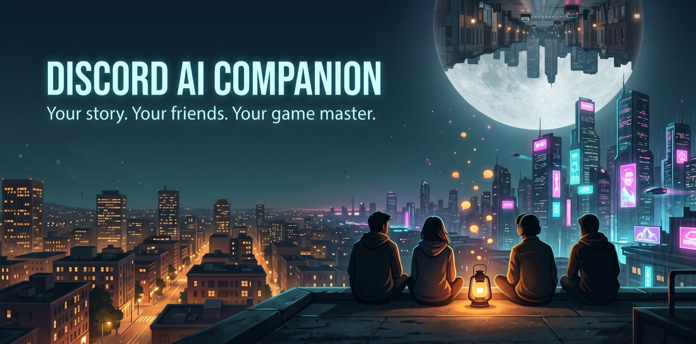
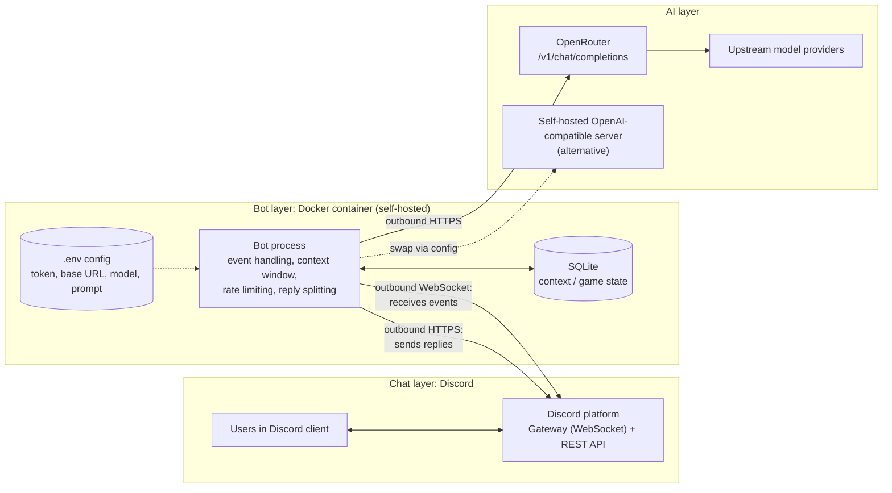
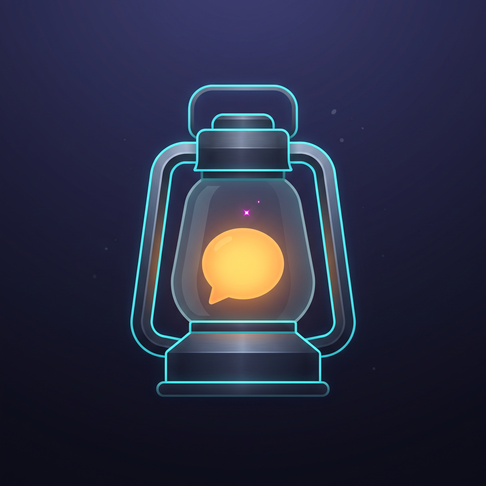

# Discord AI Companion

A private, self-hosted Discord bot that chats using any OpenAI-compatible LLM endpoint. It starts with [OpenRouter](https://openrouter.ai). The longer-term goal is a **Game Master mode**: the bot runs a shared, story-driven adventure for the people in a channel.

> **Status:** Chat MVP is code-complete and tested. Next step: a live test against a real Discord server. See [Roadmap](#roadmap).

## Roadmap

| Phase | Scope | Status |
|---|---|---|
| 0 | Project scaffold, config, LLM client, message splitter, Docker stack | Done |
| 1 | Chat MVP: Discord connection, `@mention` + `/ask`, SQLite context, rate limiting | Built; awaiting live test |
| 2 | Game Master mode | Designed, not started |
| Later | Public-bot features (see [Future](#future-public-bot-considerations)) | Parked |

## Architecture



**Every connection starts from the bot.** It opens a WebSocket to Discord's Gateway and receives events over it, and it sends replies through Discord's REST API. Nothing connects in to the host, so there's no port forwarding, public URL, or firewall change. The LLM is just a base URL, so OpenRouter can be swapped for any OpenAI-compatible server (Ollama, vLLM, LM Studio, ...) through config alone.

## Tech Stack

| Concern | Choice |
|---|---|
| Language | Python 3.12+ |
| Env / deps | [uv](https://docs.astral.sh/uv/) (`pyproject.toml` + `uv.lock`) |
| Discord | [discord.py](https://discordpy.readthedocs.io/) |
| LLM client | `openai` SDK with a configurable `base_url` |
| Validation / config | Pydantic + pydantic-settings |
| Storage | SQLite via `aiosqlite` |
| Tests | pytest + pytest-asyncio. The LLM and Discord are mocked, so no network is needed. |
| Lint / format | ruff |
| Deployment | Docker Compose |

Python was chosen because most of the work is prompt assembly, structured-output validation, and LLM plumbing, and Python's ecosystem is strongest there.

## Getting Started

### 1. Create the Discord application

A private bot needs no approval or review. A "bot" is just an *application* you create yourself.

1. In the [Discord Developer Portal](https://discord.com/developers/applications), click **New Application** and give it a name.
2. On the **Bot** tab:
   - Reset and copy the **token**. It goes in `.env` and is never committed.
   - Turn **Public Bot** off so only the owner can invite it.
   - Leave **Message Content Intent** off unless we decide to read non-mention messages. Mentions, DMs, and slash commands work without it.
3. Under **OAuth2 → URL Generator**:
   - Scopes: `bot`, `applications.commands`
   - Bot permissions: View Channels, Send Messages, Send Messages in Threads, Read Message History
4. Open the generated URL and add the bot to your server. You need Manage Server permission there.

Discord verification only applies once a bot reaches **100 servers**.

**Slash-command sync:** with `DISCORD_GUILD_ID` set, commands appear in that server instantly. Commands synced *globally* by an earlier run without it stay registered, so if `/ask` shows up twice, that's the cause. If sync fails (wrong server ID, or the bot was invited without the `applications.commands` scope), the bot logs the error and keeps running; @mentions still work.

### 2. Configure

```sh
cp .env.example .env
```

| Variable | Required | Default | Purpose |
|---|---|---|---|
| `DISCORD_TOKEN` | yes | | Bot token |
| `DISCORD_GUILD_ID` | | | Server ID for instant slash-command sync. If unset, commands sync globally. |
| `LLM_API_KEY` | yes | | API key for the LLM endpoint |
| `LLM_MODEL` | yes | | Model ID, e.g. an OpenRouter model slug |
| `LLM_BASE_URL` | | `https://openrouter.ai/api/v1` | Any OpenAI-compatible endpoint |
| `LLM_TIMEOUT_SECONDS` | | `60` | Per-request timeout |
| `LLM_MAX_RETRIES` | | `1` | Retries on transient errors |
| `LLM_MAX_TOKENS` | | provider default | Cap on reply length. Replies cut off at the cap are marked *(reply truncated)*. |
| `SYSTEM_PROMPT` | | friendly assistant | Bot persona and instructions |
| `CONTEXT_MESSAGES` | | `20` | Recent messages kept and sent as context |
| `CONTEXT_MAX_CHARS` | | `24000` | Character budget for context, so history can't outgrow the model's context window |
| `RATE_LIMIT_PER_MINUTE` | | `5` | Per-user request limit |
| `GLOBAL_RATE_LIMIT_PER_MINUTE` | | `20` | Limit across all users, to protect the provider account's quota |
| `DATABASE_PATH` | | `data/companion.db` (`/data/companion.db` in Docker) | SQLite file location |

Secrets are typed as `SecretStr`, so they're masked in logs and error output. If required values are missing, startup fails fast and names the missing variables, never their values.

### 3. Run

```sh
docker compose up -d --build
docker compose logs -f
```

It runs as a named container (`discord-ai-companion`) and is portable to any Docker host.

Container hardening:
- **Non-root user:** the bot runs as uid 10001.
- **Read-only filesystem:** the only writable paths are `/data` (a named volume holding SQLite) and `/tmp`.
- **Locked down:** all Linux capabilities are dropped and `no-new-privileges` is set.
- **Resource caps:** memory is limited to 256 MB and processes to 100.
- **No published ports:** all traffic is outbound.
- **Secrets stay out of the image:** they're injected at runtime from `.env` and excluded from the build context.

## Development

```sh
uv sync                  # create .venv with all deps
uv run pytest            # run tests
uv run ruff check .      # lint
uv run ruff format .     # format
```

Rules:
- Every change ships with tests.
- Nothing is committed until the full test suite and lint pass.
- Secrets live only in `.env`, which git ignores.

Layout:

```
src/companion/
  config.py      # settings from env, validated, secrets masked
  llm.py         # OpenAI-compatible chat client + error mapping
  store.py       # SQLite conversation context per channel/thread
  ratelimit.py   # per-user sliding-window rate limiter
  chat.py        # conversation logic (prompt building, errors), Discord-free
  bot.py         # thin Discord adapter: @mention, /ask
  splitter.py    # split replies to Discord's 2000-char limit, code-block aware
  __main__.py    # entry point (python -m companion)
tests/           # mirrors src; LLM and Discord are faked
```

## Phase 1: Chat MVP

**Goals**
- A private bot for our own server(s).
- Useful in conversation: it answers when asked and keeps enough context to follow a discussion.
- Provider-agnostic: switching LLMs is a config change.

**Non-goals for now**
- Being a public or verified bot, or billing.
- Ambient participation, where the bot joins conversations without being addressed.
- Long-term per-user memory, tool use or agent actions, and per-server configuration.

**Scope**
- **Triggers:**
  - `@mention` replies in the same channel or thread.
  - Replying to one of the bot's messages counts as a mention, as long as the reply ping is left on.
  - `/ask <prompt>` defers the interaction (Discord requires an acknowledgment within 3 seconds), then posts the answer as a follow-up.
  - `/reset` clears the bot's memory of the current channel or thread. By default it needs Manage Messages; server admins can change that under Server Settings → Integrations.
  - Not triggers: replies with the ping turned off, @mentions of the bot's *role*, system messages, webhooks, and other bots.
- **Context:** a rolling window of **bot-directed messages only**, per channel or thread: prompts sent to the bot and its replies. Other channel chatter is never read, so the privileged Message Content intent isn't needed. Each prompt is stored with the speaker's display name so the bot can tell people apart, and its formatting (newlines, code) is preserved. History is capped by message count and a character budget, and always starts on a user turn. Requests in the same channel are handled one at a time, so each sees the previous exchange. Context lives in SQLite and survives restarts. An exchange is only stored if the LLM answered.
- **Server-only:** DMs are ignored and slash commands are guild-only. This stops people outside the server from using up the API quota.
- **Mention safety:** all bot messages are sent with mentions disabled, so LLM output can never ping `@everyone`, roles, or users.
- **Output:** replies over 2000 characters are split at paragraph, line, or word boundaries. Code blocks are closed and reopened across chunks. No streaming, because repeatedly editing a message hits Discord rate limits.
- **Limits:** per-user and global rate limits. A rate-limited user is told once per window, and further messages in that window are silently ignored, so spam doesn't turn into bot spam.
- **Errors:** friendly messages when the LLM is rate-limited, unavailable, times out, or returns something malformed (e.g. a wrong `LLM_BASE_URL`). The provider's error text is logged to help diagnosis. If the user deleted their message while waiting, the answer is still posted.

## Phase 2: Game Master Mode

The bot runs a **shared, story-first adventure** for the people in a channel. Everyone experiences a story together, rather than playing a hack-and-slash game with detailed stat tracking.

### Design principles
- **Narrative over mechanics.** Rules-light, with no detailed HP, spell points, or loot tracking.
- **Bounded adventures.** Each game has a beginning, middle, and end, and there's no character progression across campaigns.
- **The database is canon.** Story continuity lives in structured storage, not in the chat transcript.
- **Code adjudicates, the LLM narrates.** Dice, turn handling, and state validation are code. Description, NPCs, and consequences come from the LLM.

### Anti-drift architecture
Long AI roleplay usually degrades for four reasons: the transcript is the only memory, summaries lose specifics, nothing is canonical, and the story has no destination. Each has a countermeasure:

| Problem | Countermeasure |
|---|---|
| No destination, endless wandering | **Hidden adventure outline** generated at game start: premise, 3–4 acts, key NPCs and secrets, possible endings. Players don't see it. |
| Nothing is canonical | **Story bible** in the DB: characters, NPCs, places, significant items, established facts, open threads. |
| Transcript grows until details fade | **Prompt rebuilt fresh each round** from the outline, current act, bible, rolling summary, and the last few rounds only. |
| New facts get lost | **Canon extraction:** each round the LLM returns new or changed facts as JSON, which code validates and stores. |
| Drift goes uncorrected | **Player tools:** `/recap`, `/canon`, and a way to flag contradictions. |

This greatly reduces drift but cannot eliminate it. Model choice matters, especially for following the facts given in the prompt and for producing reliable JSON.

### Structured output (prerequisite)
Game state updates come back from the LLM as JSON, so parsing, validating, and retrying JSON responses will be a first-class, tested component. We won't rely on native tool calling, since support is inconsistent across models.

### Light mechanics
- Code rolls dice only when an outcome is uncertain. Results are **success / partial success / failure**.
- **Conditions** ("wounded", "lost the map", "owes the smugglers") replace HP and stats.

### Turn flow: collect, then resolve
1. The GM narrates the scene and opens a round.
2. Players each submit an action (`/act ...`) in any order.
3. When all players have acted, or a timeout expires, code resolves the rolls and the LLM narrates the round in one reply, then updates canon.

This avoids blocking on AFK players and keeps LLM usage to about 1–2 calls per round.

## AI Provider and Privacy

We start with **OpenRouter free models**. The bot depends only on basic `/v1/chat/completions`.

Caveats with free models (check OpenRouter's current docs, since limits change):
- **Tight request limits,** both per minute and per day. The daily cap is higher once credits have been purchased.
- **Models come and go,** so the configured model may disappear.
- **Prompt logging:** some free providers may log prompts or train on them.

**Privacy:** messages the bot uses as context are sent to the configured LLM provider. Server members should be told this, for example with a pinned note in the channels where the bot is active.

## Open Questions

**Chat MVP**
- [x] **Context contents:** bot-directed messages only.
- [ ] **Persona:** one fixed system prompt, or a configurable personality?
- [ ] **Channels:** active everywhere, or only in an allowlist?

**Game Master mode**
- [ ] **Pacing:** live sessions, async over days, or both? This affects timeouts and nudges.
- [x] **Scope:** a game lives in its own sub-channel. `/game start` opens a Discord thread, and game state is keyed to that thread's ID. Game input uses slash commands (`/act`), so it's bot-directed and needs no extra intents.
- [ ] **Free-form roleplay:** should the GM also read in-character chat in the game thread, beyond `/act`? That would require the Message Content intent.
- [ ] **Characters:** quick player-made concept (name, one-line concept, a trait or two), or GM-generated?
- [ ] **Premise:** do players pick genre and tone at start, or does the GM pitch options?
- [ ] **Length:** one session (~2h), or several?

## Future: Public-Bot Considerations

These are parked until the private bot proves useful:
- Per-server config (endpoint, model, prompt) and admin commands
- Personas and long-term memory outside of games
- Tool use, with prompt-injection hardening
- Usage quotas, paywall, and cost controls
- Discord verification (required at 100+ servers) and approval for privileged intents
- Market research: competing AI and GM bots, and demand among Discord users

## License

[MIT](LICENSE)

---

<p align="center">
  
</p>
